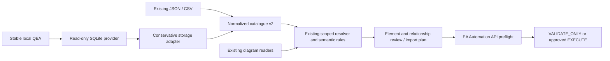

# Direct QEA Reader — implementation and engineering report

Date: 2026-10-22. Baseline: `787dfcc9bb32e2bff1f6ebf32d963eae34a0d0e8`.
Changes continue the existing feature branch; no rebuild, COM, external service,
PCS access, production mutation, or new dependency is involved.

## Local workflow

From the project directory on macOS (Python 3.11 or 3.12):

```bash
python3 -m venv .venv
.venv/bin/python -m pip install -r requirements.lock
.venv/bin/python -m streamlit run app.py --server.address 127.0.0.1
```

1. Use an EA-created, synthetic local `.qea`; close EA/stop its writers first.
2. Choose **Repository EA → Local Testing → File QEA lokal**. Enter its macOS
   path, e.g. `/Users/yourname/EA/acceptance.qea`; click **Analisis repository**.
   The browser does not upload the file. The Python backend must access that path.
3. Inspect counts, size and analysis time. Search the qualified package hierarchy,
   select the catalogue scope including required owning Pool/Lane/process elements,
   then select an output package. No GUID entry is needed for this route.
4. Open **Buka inspector read-only**. Packages, elements, diagrams, relationships,
   types/stereotypes, and diagram placements are paginated (50 rows). Element
   browsing supports name/type/stereotype/GUID filters; packages show ancestry.
   Package browsing searches the whole repository; other sections use the chosen scope.
5. In **Pengaturan lanjutan — identitas Wine**, compare the proposed Wine path
   against the repository actually opened in EA. Correct it if Wine uses another
   drive mapping; explicitly acknowledge this capture. This is a binding review,
   not proof of a globally unique repository identity.
6. Upload `examples/manager_dan_proses.drawio` in Generic/UML mode. Its two
   explicit Actor shapes can propose the same scoped Actor Manager master on
   separate pages. Match each process to its intended master (or approve a truly
   new local Activity). A plain Note named Manager cannot establish Actor identity.
7. Review element decisions and candidate paths/GUIDs. **REVIEW** is NEEDS_REVIEW;
   NEW proposals do not carry approval. Unsupported/ambiguous metadata blocks reuse.
   Confirm relationship endpoints, type, direction, name/meaning, native properties,
   existing ConnectorGUID or separately approved creation. The source arrow does
   not approve a model relationship.
8. Generate **VALIDATE_ONLY**, run in EA's JScript window, compare model counts,
   IDs and properties before/after. It must invoke no model mutators. Only after
   native acceptance succeeds, explicitly approve each NEW/CREATE and the full
   EXECUTE plan. Runtime preflight revalidates the active repository and masters.
9. After model changes, use **Segarkan repository**, reselect packages and review
   the new capture. Old mappings/identity acknowledgements are invalidated.

For JSON/CSV fallback select **Snapshot JSON/CSV (lanjutan)**. Exporter download
and technical identity/root/scope/output controls remain available in advanced
settings. Legacy CSV permits discovery, not runtime master reuse. Server production
continues to require its own authorized server snapshot/profile; a local QEA cannot
authorize server execution.

## Architecture and files



| New file | Responsibility |
| --- | --- |
| `qea_reader.py` | Schema introspection, bounded read transactions, file provenance, scope queries and inspector pagination |
| `qea_catalogue_adapter.py` | Storage-to-v2 adapter; qualified stereotypes, tag/role fingerprints and explicit uncertainty |
| `repository_providers.py` | Local QEA and existing JSON snapshot providers; no fake production provider |
| `repository_cache.py` | Private, bounded derived catalogue cache with provenance/version/digest checks |
| `repository_inspector.py` | Local path discovery, package selection, metadata inspection and advanced snapshot fallback |
| `tests/qea_fixture.py` | Synthetic SQLite schema and small/large fixtures, no customer data |
| `tests/test_qea.py`, `tests/test_qea_app.py` | Read-only, semantic, cache, API-contract and default UI tests |
| `tests/benchmark_qea.py` | Reproducible large synthetic benchmark with assertions and measured memory |

| Modified file | Change |
| --- | --- |
| `app.py` | Use sidebar QEA catalogue in shared review; legacy name suggestions no longer pre-bind GUIDs without semantic evidence |
| `catalogue_snapshot.py` | Reusable dictionary normalization; provenance trust boundary; indexed hierarchy validation; v2/CSV compatibility |
| `import_plan.py` | Conservative element proposals; unknown-metadata rejection; direct-capture freshness and local identity review gates |
| `repository_profiles.py` | Non-secret explicit QEA/Wine identity-review flag |
| `repository_review.py` | New repository controls, proposal reasons and Indonesian review column labels |
| `runtime/importer.js` | Enforce local capture review and disclose identity confidence; existing preflight/approval rules retained |
| `.gitignore` | Exclude SQLite sidecars as well as existing repositories/cache/private snapshots |
| `tests/test_app.py` | Explicitly exercise advanced legacy route; name-only suggestion must wait for manual binding |
| README and docs | Current workflow, acceptance procedure, architecture, verification and limitations |

The earlier failure arose because visual conversion created elements without
canonical repository identity. P0 introduced the shared governed resolver; this
milestone supplies it with direct repository knowledge and safer proposals.
Parser/layout frameworks and input formats remain unchanged. No direct SQL writer
exists in application code. SQL fixture construction occurs only in tests.

## Supported storage contract and uncertainty

Core tables are introspected: `t_package`, `t_object`, `t_connector`, `t_diagram`,
`t_diagramobjects`, `t_objectproperties`. Optional metadata comes from `t_xref`,
`t_connectortag`, and known GUID observations in `t_genopt`. A missing required
table/column fails with an actionable error. Optional missing connector-end/tag
fields make that connector incomplete; defaults are not invented to authorize reuse.

`t_object.Stereotype` short names are qualified only by an unambiguous
`t_xref` Stereotypes `FQName=...;` entry or an already-qualified stored name.
Unknown MDGs/xrefs are retained as names/fingerprints with NEEDS_REVIEW. Non-default
classifier, NType, PDATA, StateFlags and unsupported connector/end fields also
require review. This is a supported storage subset, not exhaustive EA schema parity.

Element Notes/documents are never selected. Safe business/OPCO/BPMN tags are
whitelisted; memo bodies and connector/role Notes are hashed, not exported. Memo
semantic identifiers remain unsupported. Connector roles map explicit native
columns for role, cardinality, aggregation, navigation, containment, visibility,
alias, qualifier, derived and ordering. Missing/unknown enum values block reuse.
Even a complete synthetic mapping must agree with the Automation API at runtime.

Pool/Lane/Task candidates retain actual ParentID and native BPMN2.0 stereotypes,
plus required semantic tag fingerprints. Wrong-parent reuse blocks. Existing
Sequence/Message/Data/Association and conservative ArchiMate rules remain in the
shared resolver. Participant/partition/process semantic references remain P1 and
are blocked when not verifiable; no fake name reference or Note fallback is added.

## Read-only access, consistency and identity limits

- SQLite uses URI `mode=ro`, connection `query_only`, disabled extensions and an
  authorizer denying DML, DDL, ATTACH and writable PRAGMAs. Connections close after
  one read transaction, including errors. Queries use parameterized filter values
  and introspected/static identifiers. A query deadline and metadata limits apply.
- Presence of `-wal`, `-shm`, `-journal`, or a WAL-mode header rejects reading.
  Do not manually remove sidecars or raw-copy active databases. A future SQLite
  Backup API provider should capture a consistent snapshot using SQLite's locking
  protocol, then validate it and record provenance; it is not implemented here.
- Provenance combines canonical path, file size, mtime/ctime, device/inode,
  SQLite header hash/change counter and schema fingerprint. Signals are checked
  before/after capture and before plan generation; mtime alone is not trusted.
  Large nanosecond timestamps are strings to preserve ES3 plan digest precision.
- These signals detect ordinary local drift, not cryptographic/global identity.
  No repository GUID is fabricated. Observed repository/project GUID metadata is
  disclosed as cloneable and never used alone to authorize execution.
- Wine's proposed `Z:` path requires review. Runtime checks actual sanitized EA
  ConnectionString identity, root/scope/output, native IDs/GUIDs, types, parentage,
  relevant tags and connector signatures. EA Automation cannot recheck the Python
  filesystem fingerprint; a generated script is not an atomic file-freshness proof.
  Re-analyze after any change. File access, profile selection and local login bypass
  do not grant production permission.
- Uploaded JSON cannot grant trusted local capture status or cause arbitrary
  backend-path probes. Only the in-process local provider/private cache can.
- Default UI access is loopback. Non-loopback binds disable path access unless an
  administrator sets `DIAGRAMGENE_QEA_ROOT` to an allowed directory. Symlinks are
  resolved before enforcing this boundary. On shared hosts/reverse proxies use
  `DIAGRAMGENE_DISABLE_LOCAL_QEA=true`, or a restricted root plus deployment access
  controls. Loopback binding cannot detect every proxy/exposure configuration.

## Bounds and caching

Default extraction: 10,000 elements, 25,000 connectors, 20,000 scoped packages,
100,000 tags/xrefs per category, 32 MiB text metadata per connection and 10-second
SQLite progress deadline. Over-limit scopes fail with a request to choose a smaller
package. A single text property above 1,000,000 characters is rejected, not silently
truncated. The inspector pages at 50 rows (reader maximum 200). Derived model
metadata is materialized within these bounds; the raw database is not loaded/copied.

The cache lives under ignored `.diagramgene/catalogue-cache/`, stores metadata
only (private directory/files), and is keyed by format version, source fingerprint
and selected scope. Version/digest/provenance checks reject corrupt/tampered entries.
At most eight files, each at most 64 MiB, are kept. Refresh bypasses the selected
scope cache. Streamlit keeps only the selected derived scope and re-probes the file
header/stat on reruns; it does not rescan all objects on each interaction. A cold
disk cache load still parses and validates metadata; it is not zero-cost.

## Verification and remaining work

See [the recorded results](qea-verification.md). Repeat automated checks with:

```bash
.venv/bin/python -m unittest discover -s tests -v
.venv/bin/python tests/benchmark_qea.py --objects 20000
```

The benchmark uses synthetic data and `tracemalloc`; its Python allocation peak
excludes SQLite native memory and process RSS. Large expanded extraction can still
use hundreds of MiB. Use smaller package scopes; UI limits are intentionally lower
than the benchmark's explicit expanded limit.

Reader, adapter, UI, proposals, governed integration and synthetic tests are
implemented. **Real EA/Wine/MDG acceptance has not run**; native schema mappings,
connector enum values, placement behavior and actual MDG ownership must be verified
against the installed EA version before release. `.qeax`, active WAL support,
server/PCS live access, TRM shared reuse, full metamodel coverage, import registry
and incremental synchronization remain outstanding. Repeated imports may create
new output diagrams; canonical master/connector reuse remains protected. There is
no atomic rollback or deletion mechanism.

Next milestone: qualify this reader against an EA-created synthetic `.qea` using
[the Wine acceptance procedure](manual-acceptance-wine.md), compare direct metadata
with the read-only Automation exporter, and add verified version-specific mappings.
Do this before expanding concurrency or production connectivity.
