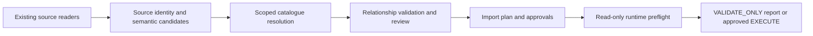

# Repository-aware import — P0

Status: implementation and automated API-contract tests; **real EA acceptance is outstanding and blocks production release**. Run [the Mac/Wine acceptance checklist](manual-acceptance-wine.md). No EA, Wine, or company repository was available in the implementation environment. Stub success does not certify Sparx Automation API or MDG behavior.

## What changed and why

The previous BPMN generator called `Elements.AddNew()` for every Pool, Lane, and Activity. Generic catalogue reuse covered some masters, but connector matching did not cover all supported role/tag metadata or repository identity. The legacy BPMN normalization could combine pools, replace data paths, and treat inferred arrows as Sequence Flows. This is unsuitable for canonical model import.

The public BPMN and Generic generators now use:

Source document/page/element IDs, master GUID/ElementID, and newly created diagram IDs are separate. A content hash is the default document ID; a stable OPCO document ID can be entered in the UI. This is a foundation for a future import registry, not incremental synchronization.

| File | Responsibility |
| --- | --- |
| `repository_profiles.py`, `repository_review.py` | Non-secret local profiles and native Streamlit element/relationship review |
| `catalogue_snapshot.py`, `ea_catalogue.py` | Versioned metadata, legacy CSV reader, GUID validation, scoped candidates, aliases and qualified package identity |
| `import_plan.py` | Shared source representation, element resolution, relationship signatures, decisions, summary and approval digest |
| `semantic_rules.py`, `model_types.py` | Explicit supported semantic types and conservative BPMN/ArchiMate relationship rules |
| `runtime/metadata.js`, `runtime/repository_identity.js` | ES3 serialization/hash, metadata contract and active repository identity |
| `runtime/importer.js` | Preflight, zero-write validation, approved execution, created-object ledger |
| `export_ea_catalogue.js`, `runtime/export_snapshot.js` | Self-contained read-only snapshot exporter and its source body |
| `drawio_to_sparx.py`, `generic_mode.py`, `visio_reader.py` | Existing readers/layout retained; public conversion routes through shared plan |
| `legacy_safety.py`, `trm_mode.py` | Local-only guard for existing TRM pending shared resolver integration |
| `tests/ea_model_stub.js`, `tests/test_repository_import.py`, `tests/test_app.py` | Strict API fixtures, safety tests and UI regression tests |

P0 did not add dependencies, a bridge, external services, or Windows requirements. The subsequent [Direct QEA Reader milestone](direct-qea-reader.md) adds a local, read-only SQLite provider using Python's built-in library. It feeds this same catalogue/planner/runtime. The local UI opens without a password; repository validation and execution approvals still apply. Legacy layout scenes remain available to existing Python callers; the import plan is authoritative for model semantics. The app uses the governed plan for BPMN previews.

## Export a target snapshot

1. Open the intended repository in Sparx EA, including EA running through Wine on macOS.
2. Select the catalogue root in the Browser. Include the relevant OPCO subpackages and both endpoints of relationships you want to reuse.
3. Download **Exporter snapshot v2 (read-only)** from DiagramGene, or open `export_ea_catalogue.js` from this repository.
4. Paste the whole script into an EA **JScript** script in **Specialize → Scripting** and run it. It only reads Automation API objects; clearing the Script output tab does not modify the model.
5. Copy only the JSON object from **Output → Script** into a private UTF-8 file such as `holding.catalogue.json`. Choose **Repository EA → Snapshot JSON/CSV (lanjutan)** and upload it. Local QEA reading is now the default; this exporter remains an optional fallback and the server snapshot path.

The exporter records package hierarchy, IDs/GUIDs, qualified paths, names/aliases, native base types, qualified stereotypes, parent elements, whitelisted business/scope/BPMN tags, and connector endpoint/role/tag fingerprints. It never exports element Notes, documents, raw connection strings, or credentials. Connector tagged values and memo bodies are fingerprinted rather than exported as text; only the non-secret Access mode is included as a semantic value. Connector Notes and role notes are also fingerprinted without exporting their text. Missing metadata blocks automatic reuse; memo business identifiers and BPMN semantic properties require manual handling. BPMN tags are also fingerprinted to detect reference/context changes. Unsupported connector metadata is explicitly marked incomplete.

JSON uses `format: diagramgene.catalogue`, `schema_version: 2`. Schema, identity, unique GUIDs, hierarchy, and relationship metadata are validated. Legacy six-column CSV remains readable for discovery/type suggestions; it cannot authorize runtime master reuse because it lacks repository identity, parents, IDs and relationship metadata. The old read-only CSV exporter is retained at `runtime/export_csv_legacy.js`.

## Choose and save a profile

Use **Target repository EA** in the sidebar:

| Profile | Default | New elements/relationships |
| --- | --- | --- |
| Local Testing | `VALIDATE_ONLY`; `.qea`/`.qeax` locator | NEW elements require profile policy and per-element approval; each new relationship requires approval |
| Holding Production | `VALIDATE_ONLY`; server identity | New elements disabled by default; no automatic catalogue master creation; each new relationship requires per-relationship approval and full-plan EXECUTE approval |

Set expected identity from the exporter, catalogue root GUID, scope package and/or OPCO, and output package GUID. Production requires a pinned output package and explicit scope. Local Testing rejects server connections; it cannot bypass server policy. Saving writes only whitelisted metadata into `.diagramgene/profiles.json`, ignored by Git. Keep snapshots and repository files private; do not commit them.

Identity is an **exact non-secret locator**, not proof from a selected profile or a package GUID. Local identity is the absolute path seen by EA, for example `Z:/Users/example/EA/local.qea`; copy the actual exporter value rather than translating the macOS path. Server identity requires an explicit provider, server/data source, and database/initial catalogue. Credentials are discarded before constructing identity. Opaque DSN/PCS/URL connections are blocked when those properties cannot be verified. No fallback to root GUID or user confirmation bypass exists. Repository clones with the same GUIDs but a different locator are rejected. A locator is not a cryptographic repository ID; replacing a database at the same endpoint/path requires a fresh snapshot and review.

Selecting another profile does not open a repository in EA. The generated script independently verifies the active connection. A configured expected identity is not silently replaced by a different uploaded snapshot.

## Upload, map, validate, execute

1. Choose BPMN or Generic UML/ArchiMate, upload a supported diagram and select pages. Existing compressed XML, embedded PNG/SVG, VSDX and TRM CSV/XLSX readers remain available.
2. Inspect semantic candidates. A box/name/arrow is only a suggestion. The old Generic mapping controls remain available; the shared review contains the final decisions.
3. In **Review impor repository-aware**, choose **REUSE** and a master GUID, or explicitly choose **NEW** and **Approve NEW**. The candidate column includes GUID, name and qualified package. No candidate is silently created. A new master appearing in the live catalogue after export blocks an accidental NEW decision. BusinessID/OPCO tags are applied only to explicitly new elements, never to reused masters. If a matching master exists, NEW additionally requires **Distinct object confirmed**, available in the advanced columns.
4. Use advanced columns for business ID, exact qualified package path, event/gateway semantics, or an intentional repeated visual reference to one master. Source OPCO metadata constrains matching. Aliases are suggestions and require explicit GUID selection. Duplicate names remain ambiguous until disambiguated. No fuzzy matching or cross-OPCO name merge occurs.
5. Review **Relationship Mapping**: endpoint names and resolved GUIDs, type, direction, name/meaning, existing ConnectorGUID, action, reason, and endpoint provenance. Confirm semantics explicitly. In production, source notation alone never counts as relationship approval. Use an existing GUID for unnamed relationships or multiple equivalent candidates. For Access, specify Read/Write/ReadWrite. **Accept existing properties** means you reviewed the existing role/tag semantics in EA; it never overwrites them.
6. Read the dry-run summary and export the metadata plan if useful. `REVIEW` and `BLOCK` prevent execution. An unresolvable source edge is an error, not a silently dropped relationship. Geometry-derived endpoint candidates remain visible for review.
7. Keep `VALIDATE_ONLY`, create/download the script and run it in the intended EA repository. The script resolves all masters/connectors and validates scope, MDGs, hierarchy, identity and signatures before any model `AddNew`/`Update`. Validation makes no model changes. Unapproved proposals may be reported in validation mode, but cannot execute.
8. Once validation and the real EA acceptance checks pass, switch to `EXECUTE`, approve each proposed new relationship, and check the full-plan approval. Changing the plan invalidates that approval. The digest binds review to the generated plan; it does not replace EA repository permissions. Generate again and run in EA. Preflight runs again; stale snapshots, changed relationships and newly discovered possible duplicates require re-export/review.

New connections between existing masters are **repository-wide model changes**. A DiagramLink merely displays a connector. An explicit per-row approval is required in both environments; production never silently adds a model relationship.

## Manager example

Use `examples/manager_dan_proses.drawio` in **Diagram umum → UML umum**. In your synthetic local catalogue, create one UML Actor `Manager` and Activities `Persetujuan anggaran` / `Persetujuan pengadaan`. Create the appropriate existing Association connectors named `bertanggung jawab`, with their intended orientation. Export the snapshot.

Map the two `manager` source rows to the **same Actor GUID**, map each process to its correct Activity GUID, select the appropriate ConnectorGUID for each relationship, and confirm semantics. The resolved endpoint names can differ from source labels because explicit GUID binding identifies the master. `VALIDATE_ONLY` must leave the repository unchanged. After approved EXECUTE, both diagrams reference the same Actor ElementID/GUID and the selected ConnectorGUIDs, while master Notes and properties remain unchanged. Repeat the import: diagrams/packages may increase, master/connector counts must not.

Alternatively approve an explicitly NEW local process and its new Association. This creates a local element; it does not create an automatically merged catalogue master. Types marked mandatory catalogue in the Generic controls require REUSE; create a missing catalogue master separately in EA and refresh the snapshot.

## Supported semantics and deliberate blocks

| Family | Supported validation | Blocked/manual handling |
| --- | --- | --- |
| BPMN physical reuse | Pool with no owning element, Lane/Activity/Event/Gateway/Data Object with exact resolved parent chain and unchanged MDG tags | Reparenting, arbitrary Pool reuse across process contexts, missing native metadata |
| Sequence Flow | BPMN flow nodes only, same Pool and subprocess scope; no outgoing End/incoming Start | Cross-Pool/subprocess links, Lane/Data/Actor endpoints |
| Message Flow | Distinct participant Pools; Activity or suitable throwing/catching Message Event endpoints; directed | Same Pool, Lane/Gateway/Data endpoints, unverified event definition/direction |
| Data Association | Activity ↔ Data Object within supported process scope | Automatic conversion from/to Sequence Flow |
| BPMN Association | Native Text Annotation ↔ flow node/Data Object | Lane endpoints, pretending UML/ArchiMate Actor is a BPMN participant reference |
| BPMN refinements | Task, Sub-Process and basic Exclusive/Parallel/Inclusive gateway candidates; None/Message events | Boundary attachment, Complex/Event-based gateways, other event definitions, unsupported semantic references |
| ArchiMate | Conservative explicit type-pair rules for Assignment, Serving, Realization, Access, Flow, Triggering, Association in `semantic_rules.py` | Pairs outside that subset, wrong orientation/layer/type; no claim of complete ArchiMate metamodel coverage |
| UML | Explicit Association, Dependency, compatible Generalization and Class/Component → Interface Realisation | Semantic type conflicts; `Realization` alias normalizes to EA base spelling `Realisation` |

Native BPMN MDG property values and base connector types still require the manual acceptance test against your installed EA/MDG version. Required MDGs must be enabled; there is no fallback to Analysis or Note. Non-default new BPMN properties are set only on native MDG tags that EA actually supplies; missing tags cause an explicit write failure and reconciliation ledger.

Physical reuse displays the **same ElementID/GUID**. A participant/partner/role/partition/process reference instead relates **different elements** using official MDG semantics. The latter is **P1, not implemented**: references discovered on masters are blocked when this implementation cannot verify them. No tag or name is fabricated to impersonate such a reference. A Lane is never silently converted into an Actor or Role. Package GUIDs define catalogue/output hierarchy; visual containers do not become catalogue packages.

Connector equivalence includes ordered endpoint GUIDs, base type, qualified stereotype, name, direction, all tagged-value fingerprints, and supported end properties: Role, Cardinality, Aggregation, Navigable, RoleType, Alias, Qualifier, Containment, Visibility, Derived and Ordering, plus fingerprints of connector/role Notes. A user must inspect richer/unsupported semantics in EA; this metadata contract does not certify every EA extension. Multiple equivalent connectors or unnamed relations require explicit ConnectorGUID selection. Existing connector properties are never updated. Repeated named proposals across pages are created once; an equivalent connector appearing after the snapshot blocks another execution until refreshed.

## Limits and follow-up work

- New output packages and diagrams are created on each execution. There is no full diagram synchronization, deletion, migration, transaction or automatic rollback.
- If writing fails, Output lists created object kinds, names and IDs/GUIDs available from EA, including objects attempted before a failed Update. Reconcile those objects manually. Do not delete/recreate catalogue masters as a recovery strategy.
- Snapshot freshness is checked through live object IDs/GUIDs, types, scope, hierarchy, relevant BPMN properties and connector signatures. Repository edits occurring concurrently between preflight and writing cannot be made atomic by this script; run under the company's normal change controls.
- TRM parsing/model generation is retained and guarded for explicitly approved **local** execution. TRM catalogue/relationship integration is P1; production TRM writes are blocked rather than silently using the legacy generator.
- P1: verified official BPMN semantic references, TRM Application Component reuse, richer metamodel and cross-catalogue policies. P2: import registry/versioning, full incremental synchronization and a separate secure live-connection design.
- The public Python conversion functions now default to governed `VALIDATE_ONLY`. Pass profile, snapshot and explicit element/relationship decisions for execution. Internal `_legacy_convert_generic` exists only for historical regression fixtures; the app/public generator never executes that path. Legacy scene-only `to_jscript()` rejects unsafe generation because it lacks source identities.

Run automated regression tests with `.venv/bin/python -m unittest discover -s tests -v`. No external metadata service or real company model is used by those tests.
